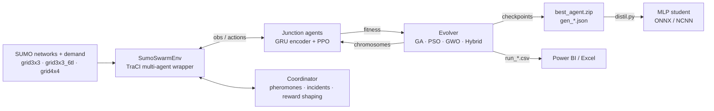

# 🚦 Sumo-Swarm

**A multi-agent traffic-signal control system: per-junction GRU-PPO agents → evolutionary hyperparameter search → incident-aware evaluation → distilled edge model.**

Each traffic light in a SUMO simulation is controlled by its own reinforcement-learning agent. Agents share congestion signals with their neighbours, and their hyperparameters are evolved with GA, PSO, GWO and a hybrid of the three. Strategies are compared across peak, off-peak and weekend demand, with random lane-closure incidents. Training results are logged to CSV for analysis in Power BI, and the best agent can be distilled into a lightweight model for deployment.

---

## Architecture

---

## Tech stack

| Area | Technologies |
|---|---|
| Language | Python |
| Simulation | SUMO, TraCI, Gymnasium |
| Machine learning | PyTorch, Stable-Baselines3 (PPO), GRU |
| Data and analysis | NumPy, pandas, Power BI, Excel |
| Deployment | ONNX, NCNN |
| Tooling | Git, GitHub, VS Code, Google Colab |

---

## Concepts applied

**Multi-agent reinforcement learning**
- One GRU-PPO agent per junction, reading a 15-step observation window
- Observation: queue lengths, phase, phase time, neighbour pheromone, incoming flow, downstream space, incident signal
- Decentralised control with a shared coordinator

**Evolutionary optimisation**
- GA, Particle Swarm Optimisation, Grey Wolf Optimiser and a hybrid of all three
- Chromosome of nine hyperparameters plus utility weights
- Elitism, periodic population restarts, self-healing and neighbour gene-sharing
- Shared or per-agent genome modes

**Reward and fitness design**
- TD(λ) and Bellman targets with learned value networks
- Rewards normalised against a baseline so scenarios are comparable
- Multi-objective fitness: wait time, queue, stops, throughput and Jain's fairness index

**Scenarios and evaluation**
- Peak, off-peak and weekend demand, weighted 70 / 15 / 15
- Random lane-closure incidents broadcast to neighbouring agents
- Pareto-front analysis of wait time against throughput

**Model deployment**
- Knowledge distillation from the GRU-PPO teacher to an MLP student
- ONNX export, with NCNN conversion steps

---

## Data

Synthetic SUMO grid networks (3×3, 3×3 with six controlled signals, 4×4). Demand files are generated with SUMO's `randomTrips.py` and `duarouter` for three scenarios: peak, off-peak and weekend. No external dataset is used.
